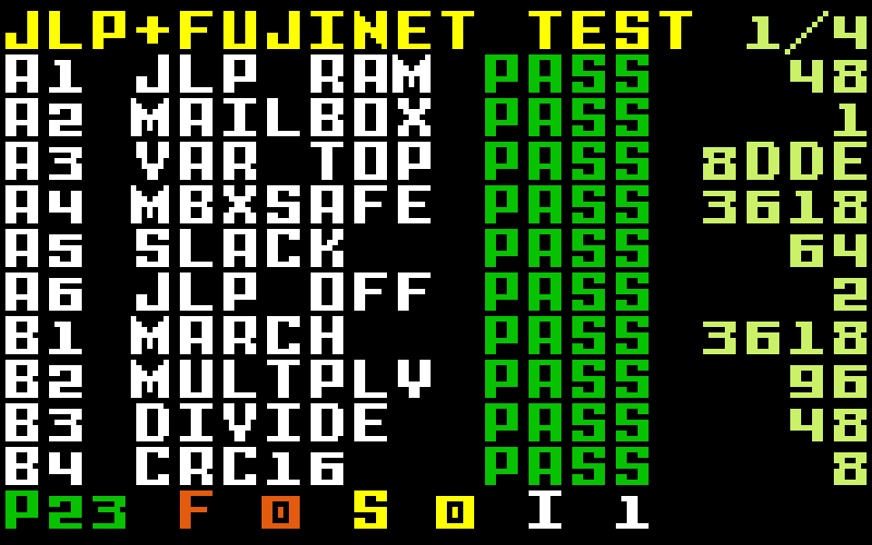

# JLP + FujiNet test for the Intellivision

An IntyBASIC program that runs JLP and the FujiNet cartridge mailbox in the
same `$8000-$9FFF` window, first one at a time and then together, and
reports what works. It is a test for the cart firmware and emulators, and
a worked example of a FujiNet-aware JLP game.

**[How JLP and FujiNet share the cartridge](docs/JLP-and-FujiNet.md)**
explains the memory map, the `[vars] fujinet = 1` opt-in, and every test.
A printable booklet is in [`docs/booklet/`](docs/booklet/).



## Running it

On a FujiNet Intellivision cart, put **`jlpfn.bin` and `jlpfn.cfg`**
side by side on a host (SD card or TNFS) and boot `jlpfn.bin` from CONFIG.
Use the pair, not a `.rom`: the cart reads `jlp`, `jlpflash` and `fujinet`
from the `.cfg`, and an Intellicart `.rom` booted over the network gets no
JLP at all.

The download tests fetch `data/pattern.bin` from this repository on
GitHub, so the FujiNet needs internet access. The AppKey test needs an SD
card in the FujiNet.

In jzIntv, use a FujiNetWIFI build that models the cart's JLP and mailbox
sharing ([jzintv#3](https://github.com/FujiNetWIFI/jzintv/pull/3), in
review; the FujiNet Go Intellivision apps follow):

```sh
jzintv --fujinet=localhost:1985 --jlp-savegame=jlpfn.jlp build/jlpfn.bin
```

`build/jlpfn.rom` runs the JLP tests alone.

## Reading the screen

Tests run at boot, ten to a page. Each shows PASS (green), FAIL (red),
SKIP (yellow) or INFO (white) and one measured value; the bottom line
counts each. Page 4 has details: SSID, IP, firmware version, time, flash
and transaction timings.

| Key | |
|---|---|
| 1 | run every test again |
| 2 | stress loop: download with JLP busy, verify, and through flash every eighth pass, until CLEAR |
| 3 or disc | next page |

Groups: **A** JLP and the mailbox sharing the window, **B** JLP alone,
**C** FujiNet alone, **D** both at once. If A2 finds no mailbox, the C
and D tests skip.

## Building

Needs IntyBASIC 1.4.2, as1600 (from jzIntv) and Python 3.

```sh
make            # build/jlpfn.bin, .cfg and .rom, plus the checks below
make dist       # dist/jlpfn.bin + dist/jlpfn.cfg
make nofuji     # the same ROM without fujinet = 1, to see the mailbox stay off
make URL=http://host/pattern.bin   # download from your own server instead
```

`make` fails if the ROM would collide with anything sharing the window:
`tools/check_map.py` checks the `.cfg` (no ROM at `$7000` or `$8000-$9FFF`,
no `[memattr]`, the right `[vars]`) and that IntyBASIC's variables end
below `$9C00`. `tools/lint_accel.py` checks that only the deliberate
accelerator tests touch `$9F80-$9FFF`, so the test harness doesn't rely on
the hardware it is testing.

## Testing headless

`tools/run-tests.sh` runs the ROM in jzIntv with its debugger, reads the
results by symbol, and checks seven scenarios: JLP alone, JLP and FujiNet
(twice, so the second boot finds the first one's flash), the `nofuji`
build, and the same three booted over the network the way CONFIG does.

```sh
JZINTV=~/jzintv/bin/linux/jzintv JZINTV_ROMS=~/jzintv/rom \
BOIP=localhost:1985 FUJINET_SD=~/fujinet-pc/build/dist/SD \
tools/run-tests.sh
```

It serves `data/` from a local web server and rebuilds the ROM to use it.
`BOIP` is a fujinet-pc (RS232 build) instance; `FUJINET_SD` is its host
slot 1 directory, used for the network-boot scenarios (skipped if unset).

## Files

| | |
|---|---|
| `src/main.bas` | entry point, test order, menu, stress loop |
| `src/tests_a.bas`, `tests_b.bas`, `tests_cd.bas` | the tests |
| `src/asmlib.bas` | software references and the deliberate JLP accesses, in CP-1610 assembly |
| `src/fujinet.bas` | mailbox transport for a JLP game (no `MEMATTR`) |
| `src/ui.bas` | screens and controller input |
| `tools/mkpattern.py` | `data/pattern.bin` and its expected CRCs |
| `lib/` | IntyBASIC 1.4.2 prologue and epilogue (BSD, see `lib/LICENSE`) |

## License

GPL-3.0; see `LICENSE`. The transport derives from the FujiNet
Intellivision programmer's guide and fujinet-config.
