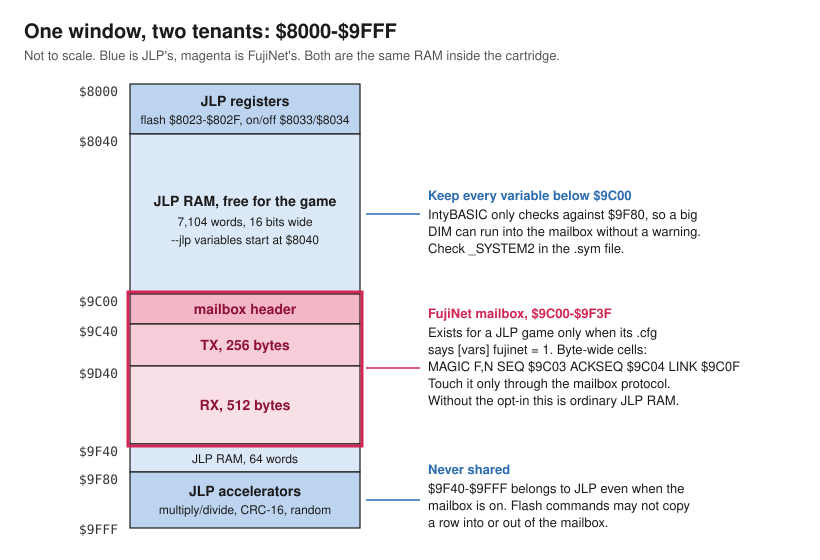
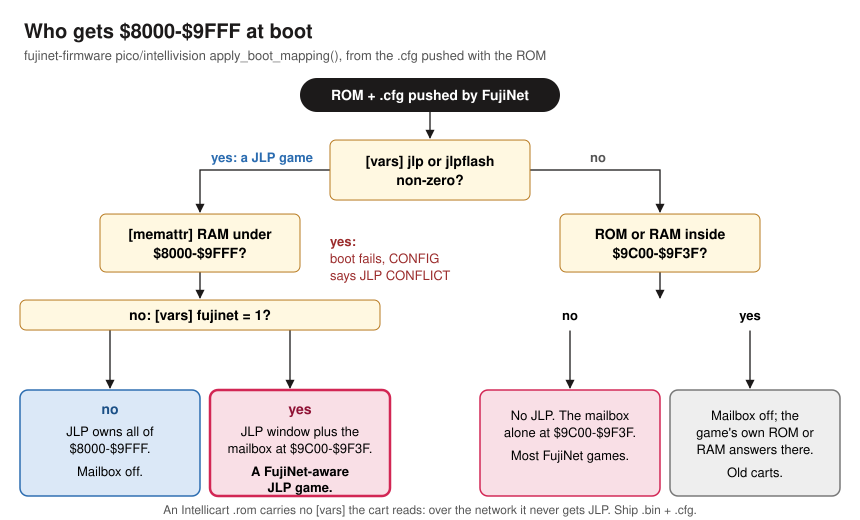
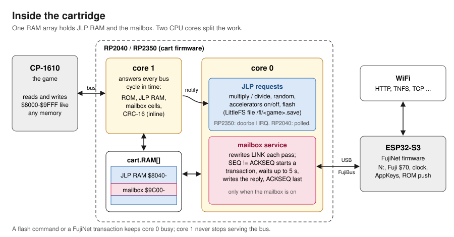
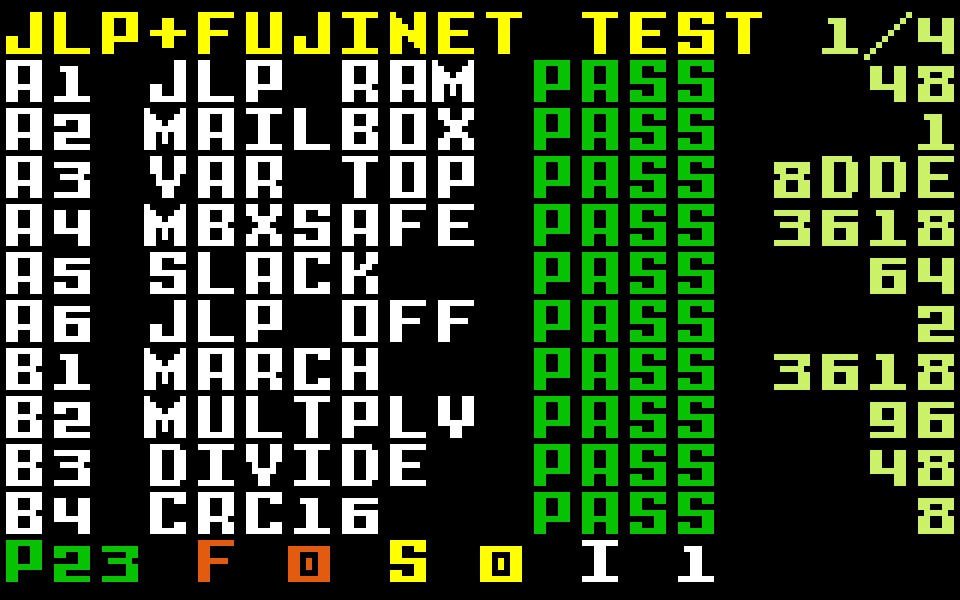
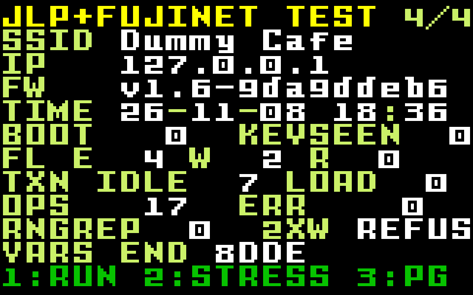
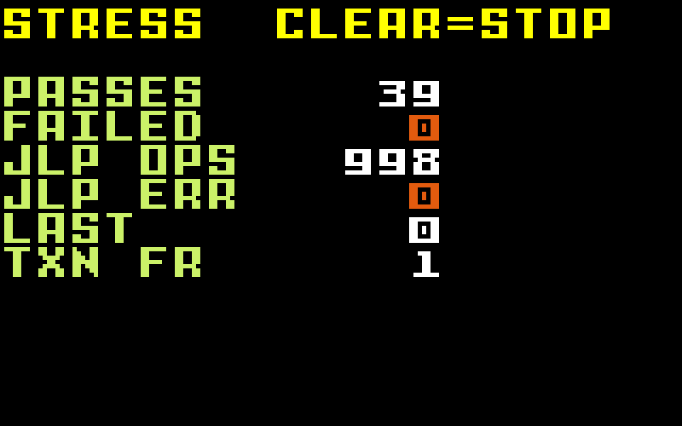

# JLP and FujiNet on the Intellivision

JLP and FujiNet both live in the same 8K-word window of the
Intellivision's memory map, `$8000-$9FFF`, and on a FujiNet cartridge they
are literally the same RAM. This page explains how they share it, what a
game has to do to use both, and what the
[test ROM in this repository](../README.md) checks.

## The two features

**JLP** is Joe Zbiciak's "Jean-Luc Project" cartridge board. Many
homebrew carts implement it (LTO Flash among them), and IntyBASIC's
`--jlp` switch targets it. It gives a game:

- 8,000 words of 16-bit RAM at `$8040-$9F7F`;
- hardware multiply and divide (`$9F80-$9F8F`), a CRC-16 unit (`$9FFC`,
  `$9FFD`) and a random number register (`$9FFE`);
- save-game flash: rows of 96 words in 8-row sectors, copied to and from
  JLP RAM by commands at `$8023-$802F`.

**FujiNet** on the Intellivision is a cartridge with two processors: an
RP2040 or RP2350 that answers the console's bus (firmware descended from
PiRTO II and Minty) and an ESP32-S3 running the FujiNet firmware, joined by
USB. The console talks to FujiNet through a **mailbox**: 832 words of cart
RAM at `$9C00-$9F3F` holding a header (sequence numbers, device, command,
parameters, status), a 256-byte transmit buffer and a 512-byte receive
buffer. The console fills in a request and bumps `SEQ`; the cart carries it
to the ESP32, writes the reply and sets `ACKSEQ` last.

The cart emulates JLP too, so JLP games run on it. Its RAM for the JLP
window and the mailbox is one array.

## The memory map

| Range | Owner | Notes |
|---|---|---|
| `$8000-$803F` | JLP | Registers: flash first/last row `$8023`/`$8024`, flash address/row `$8025`/`$8026`, commands `$802D-$802F`, accelerators on/off `$8033`/`$8034` |
| `$8040-$9BFF` | JLP | 7,104 words of RAM for the game |
| `$9C00-$9F3F` | FujiNet | The mailbox, when the game opts in; otherwise plain JLP RAM |
| `$9F40-$9F7F` | JLP | 64 more words of RAM |
| `$9F80-$9FFF` | JLP | Multiply/divide, CRC-16, random numbers |

A FujiNet-aware JLP game therefore gives up 832 words of JLP RAM. Nothing
else changes: the accelerators, the flash commands and the RAM on either
side of the mailbox behave as they would on any JLP board.

## How the cart decides

When FujiNet boots a game (CONFIG's MOUNT_IMAGE), the ESP32 pushes the ROM
and its `.cfg` to the cart, and the cart maps the game from the `.cfg`.

| The game's `.cfg` | `$8000-$9FFF` | Mailbox |
|---|---|---|
| no `jlp` or `jlpflash` | game ROM/RAM, if any | at `$9C00-$9F3F`, unless the game's own memory covers it |
| `jlp` or `jlpflash`, no `fujinet` | JLP | off |
| `jlp` or `jlpflash`, and `fujinet = 1` | JLP | at `$9C00-$9F3F` |
| `jlp` and any `[memattr]` RAM under `$8000-$9FFF` | — | boot fails; CONFIG shows JLP CONFLICT |

Two consequences:

- **The opt-in lives in `[vars]`.** A JLP game that doesn't know about
  FujiNet never sees a mailbox, so nothing it writes to high JLP RAM can
  start a network transaction. One that does know adds `fujinet = 1`.
- **Ship a `.bin` + `.cfg`, not a `.rom`.** The cart ignores the
  metadata in an Intellicart `.rom` when booting over the network, so a
  `.rom` gets neither JLP nor the opt-in.

## Inside the cartridge

Core 1 of the RP2040/RP2350 does nothing but answer the bus. It serves
reads and writes of JLP RAM and of the mailbox from the same array, and it
runs the CRC-16 step itself. Everything slower goes to core 0: the
multiply and divide results, refilling the random-number buffer, flash
commands (each a LittleFS file operation on the cart's own flash, in
`/fl/<game>.save`), and the mailbox service loop that ships requests to the
ESP32.

How core 0 hears about JLP work differs between the chips:

- **RP2350** (the FujiNet INTV board): core 1 rings a doorbell interrupt
  on every JLP register access, so the accelerators answer even while
  core 0 waits for the ESP32.
- **RP2040** (PiRTO II boards): core 0 checks for JLP work once per pass of
  its main loop. While it waits on a FujiNet transaction it doesn't check,
  so multiply/divide results and flash commands stall for up to the
  transaction's length. See [Known issues](#known-issues).

A flash command keeps core 0 busy on both chips; the mailbox waits for it.

## Writing a FujiNet-aware JLP game in IntyBASIC

1. Build with `intybasic --jlp`. If you use flash, start with
   `FLASH INIT SIZE n` (IntyBASIC then emits `jlp = 3` and `jlpflash = n`).
2. Opt in to the mailbox: `ASM CFGVAR "fujinet" = 1`. as1600 copies it
   into the `.cfg`'s `[vars]`.
3. Assemble to a `.bin` + `.cfg` (`as1600 -o game game.asm`, no
   extension, writes both and a `.rom`) and put the `.bin` and `.cfg`
   side by side on the FujiNet host.
4. Use a mailbox transport **without** the `ASM MEMATTR $8000, $9BFF, "+RWN"`
   line the non-JLP FujiNet games carry. JLP already provides RAM there,
   and declaring `[memattr]` RAM under `$8000-$9FFF` stops the game from
   booting. [`src/fujinet.bas`](../src/fujinet.bas) is such a transport.
5. Keep every 16-bit variable below `$9C00`. IntyBASIC only warns at
   `$9F80`, so it will happily put a large `DIM` across the mailbox. Look
   up `_SYSTEM2` in the `.sym` file; this repository's
   [`tools/check_map.py`](../tools/check_map.py) fails the build for you.
6. Derive `SEQ` from the cart's `ACKSEQ` (`ACKSEQ + 1`, skipping 0), never
   from a counter of your own: a console reset restarts your program but
   not the cart.
7. Use `FLASH.FIRST` for flash row numbers. It is 0 on the cart and 224 in
   jzIntv. And never point a flash command's RAM address at the mailbox.

### Things to know

- **IntyBASIC 1.4.2 vs 1.5.** With `--jlp`, 1.4.2 clears JLP RAM only up to
  its last variable at startup. 1.5.x clears all of `$8040-$9F7F`, which
  wipes the mailbox header, magic included. The mailbox still works (the
  cart rewrites `LINK` on every pass, so a write of `$A5` to `$9C0F` turning
  back into 0 or 1 proves it is there), but a transport that waits for the
  `F`,`N` magic will give up.
- **Turning the accelerators off.** `$8034` turns JLP's accelerators off and
  `$8033` back on. The mailbox keeps working either way. On the cart, JLP
  RAM stays visible while the accelerators are off if the game has flash;
  real JLP and jzIntv hide it.
- **Multiplication is an accelerator access.** With `--jlp`, IntyBASIC
  compiles `*` by anything but a small constant, `/` and `MOD` into JLP
  register accesses. On an RP2040 cart that matters while a transaction is
  in flight (see above).

## Emulators

FujiNetWIFI's jzIntv models the cart once its JLP change lands (in review;
the FujiNet Go Intellivision apps follow):

- the FujiNet peripheral answers `$9C00-$9F3F` only;
- a JLP game keeps the mailbox only with `[vars] fujinet = 1` in its `.cfg`,
  whether it is loaded from the command line or pushed by FujiNet, and JLP
  then stands aside on `$9C00-$9F3F`;
- flash commands whose RAM span touches the mailbox are refused;
- `LINK` is rewritten continuously, as on the cart.

Earlier builds registered the FujiNet peripheral over `$9C00-$9FFF` on top
of JLP. jzIntv's bus ANDs the readers of an address together, so with both
enabled the mailbox handshake never completed and the multiply/divide,
CRC and random-number registers read as zero. The test ROM shows exactly
that on an old build: A2 finds no mailbox, A5 and B8 fail because the high
JLP RAM reads back only 8 bits, and B2-B5 fail.

In jzIntv, the opt-in is read from a `.cfg` only, as on the cart: run the
`.bin` (jzIntv finds the `.cfg` beside it) to get the mailbox, or the `.rom`
to test JLP alone.

## The test ROM

[`jlpfn.bin` + `jlpfn.cfg`](../README.md) runs 24 tests at boot, ten to a
screen, then shows a details page. Results are PASS (green), FAIL (red),
SKIP (yellow) or INFO (white) with one measured value.

 

| Test | Proves |
|---|---|
| **A1** JLP RAM | 16-bit JLP RAM is there, and flash has the 48 rows the `.cfg` asked for. Value: rows. |
| **A2** MAILBOX | The mailbox answers inside the JLP window: magic `F`,`N`,1, and `LINK` comes back from `$A5` to 0/1. SKIP: no mailbox (all FujiNet tests then skip). INFO: live, but its header was cleared. |
| **A3** VAR TOP | IntyBASIC's 16-bit variables end below `$9C00`. Value: `_SYSTEM2`. |
| **A4** MBXSAFE | Filling and checking every free JLP RAM word up to `$9BFF` leaves the mailbox header untouched and starts no transaction. |
| **A5** SLACK | `$9F40-$9F7F`, between the mailbox and the accelerators, is full 16-bit JLP RAM. |
| **A6** JLP OFF | Accelerators off and on again: the mailbox stays visible and variables survive. Value: 1 = JLP RAM stayed visible while off, 2 = it read `$FFFF`. |
| **B1** MARCH | Four address-dependent patterns through all free JLP RAM below the mailbox. |
| **B2** MULTPLY | All four multiplies against a software reference, both result words, plus IntyBASIC's own `*`. |
| **B3** DIVIDE | Signed and unsigned divide, quotient and remainder, plus IntyBASIC's `/` and `MOD`. |
| **B4** CRC16 | Known-answer vectors through the CRC unit (computed on the host by `tools/mkpattern.py`). |
| **B5** RANDOM | 256 reads of `$9FFE`: not stuck, not repeating every 4 reads, not zeros. |
| **B6** FLASH | Erase, write and read back rows in two sectors, timed. Also writes one row twice without erasing and records what happened (details page). |
| **B7** ERASE | Erasing row 8 erases sector 1 and leaves sector 0 alone. |
| **B8** RANGE | A flash read whose 96-word destination runs past `$9F7F` is refused. |
| **B9** BASICFL | The same round trip through IntyBASIC's `FLASH` statements. Skipped if any command above read its key back, which would crash IntyBASIC's flash routine. |
| **C1** WIFI | Fuji `$FA`: WiFi connected (3). |
| **C2** ADAPTER | Fuji `$C4`: the 240-byte adapter config (SSID, IP and version on the details page). |
| **C3** CLOCK | Clock device `$45`, command `$93`: a plausible date and time. |
| **C4** APPKEY | Writes 64 fresh bytes to AppKey `$0909`/`$03`/`$00` and reads them back. SKIP if the FujiNet has no SD card. |
| **C5** HTTPGET | `N:` downloads `data/pattern.bin` (3,072 bytes) into JLP RAM, checking every byte, plus a software CRC of the whole. |
| **D1** ASYNC | The same download with JLP work (RAM, multiply, divide, CRC, random) running for as long as each READ is in flight, every result checked. Value: JLP operations done during transactions. |
| **D2** NET CRC | The JLP CRC unit, fed the downloaded words, produces the CRC the host computed for the file. |
| **D3** NET>FL | The downloaded data to flash (16 rows), read back, compared; then a header row. Value: frames. |
| **D4** PERSIST | Run at boot: the previous run's D3 data is still in flash and its CRC checks. Value: boot count. INFO on the first boot. |

Keypad: **1** runs everything again, **2** starts the stress loop (D1-D2
repeatedly, through flash every eighth pass, until CLEAR), **3** or the
disc turns the page.

## Known issues

Found while writing the test ROM. Each has a test that shows it.

| Issue | Where | Test | Status |
|---|---|---|---|
| Flash erase picks the sector as `row % 8` instead of `row / 8`: erasing rows 8-15 erases sector 0 | cart firmware | B7 | fix in progress |
| Flash row and RAM address are not range-checked; a span can overwrite the accelerators or the mailbox | cart firmware | B8 | fix in progress |
| RP2040 carts serve JLP accelerators and flash only between core-0 loop passes, so results go stale and flash stalls during a FujiNet transaction | cart firmware | D1, B9 | fix in progress |
| jzIntv put the mailbox on top of JLP | jzIntv | A2, A5, B2-B5 | fix in review |
| `jlp = 2` means "accelerators off at reset" to jzIntv and JLP, "on" to the cart | cart firmware | — | open |
| An Intellicart `.rom` booted over the network gets no JLP | cart firmware | — | open |
| The cart lets a flash row be written twice without an erase; JLP and jzIntv refuse | cart firmware | B6 (details) | open |
| A JLP game without flash that turns the accelerators off can't turn them back on: the cart drops the `$8033` write | cart firmware | — | open |
| IntyBASIC 1.5 `--jlp` clears the mailbox at startup; on a console reset the cart can replay the last command | IntyBASIC / cart | A2 | open |
